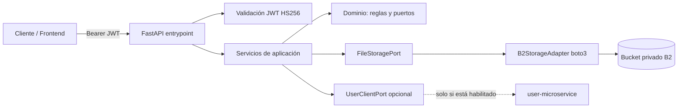

# File Microservice

Microservicio de archivos construido con **FastAPI** y **arquitectura hexagonal**
(domain / application / infrastructure / entrypoint). Almacena la foto de perfil
y los documentos PDF de cada usuario en un **bucket privado de Backblaze B2**
usando su API compatible con S3.

- Sin base de datos: los metadatos viven en el propio objeto de B2.
- Sin Kafka: no consume ni publica eventos.
- No modifica el `user-microservice`: solo comparte su `JWT_SECRET` y,
  opcionalmente, consulta su API.
- Una sola foto por usuario y múltiples documentos PDF.
- Bucket privado con URLs de descarga prefirmadas de corta duración.

---

## Arquitectura



```
app/
├── domain/                  # No depende de FastAPI, boto3 ni httpx
│   ├── model/               # StoredFile, Actor, FileResult, ...
│   ├── valueobject/         # UserId, DocumentId, FileCategory
│   ├── exception/           # Errores de negocio
│   └── port/
│       ├── inbound/         # Casos de uso (Protocols)
│       └── out/             # FileStoragePort, UserClientPort
├── application/
│   ├── dto/                 # Contratos de entrada/salida
│   └── service/             # PhotoService, DocumentService, validador, claves
├── infrastructure/
│   ├── adapter/storage/     # B2StorageAdapter (boto3)
│   ├── adapter/client/      # Cliente opcional de user-microservice
│   └── config/              # Contenedor de dependencias
└── entrypoint/rest/         # Routers, JWT, esquemas, manejo de errores
```

### Layout de objetos en B2

| Recurso | Clave S3 | Cardinalidad |
|---|---|---|
| Foto | `users/{user_id}/photos/profile` | Una por usuario (se sobrescribe) |
| Documento | `users/{user_id}/documents/{document_id}.pdf` | Múltiples |
| Todos | `users/{user_id}/` | Prefijo del usuario |

`document_id` es un UUID4 hexadecimal de 32 caracteres. El nombre original del
archivo se guarda como metadata ASCII en Base64 (`original-name-b64`), porque no
existe base de datos donde persistirlo.

---

## Requisitos

- Python 3.12+ (probado en 3.13).
- Credenciales de una **Application Key** de Backblaze B2 con acceso al bucket.
- El `JWT_SECRET` del `user-microservice` (codificado en Base64).

## Configuración

```bash
cp .env.example .env
```

Variables principales:

| Variable | Descripción | Default |
|---|---|---|
| `JWT_SECRET` | Mismo secreto Base64 del user-microservice | Secreto de desarrollo |
| `JWT_ALGORITHM` | Algoritmo del JWT | `HS256` |
| `B2_KEY_ID` | `keyID` de la Application Key | — |
| `B2_APPLICATION_KEY` | `applicationKey` | — |
| `B2_BUCKET_NAME` | Bucket privado | `certificados-lab-dev-2026` |
| `B2_ENDPOINT_URL` | Endpoint S3 de B2 | `https://s3.us-east-005.backblazeb2.com` |
| `B2_REGION` | Región de la cuenta | `us-east-005` |
| `MAX_PHOTO_BYTES` | Tamaño máximo de foto | `5242880` (5 MB) |
| `MAX_DOCUMENT_BYTES` | Tamaño máximo de PDF | `20971520` (20 MB) |
| `PRESIGNED_URL_TTL_SECONDS` | Vigencia de URL de descarga | `300` |
| `DEFAULT_LIST_LIMIT` | Tamaño de página por defecto | `20` |
| `MAX_LIST_LIMIT` | Tope de página | `100` |
| `CORS_ORIGINS` | Orígenes separados por coma o `*` | `*` |
| `USER_SERVICE_ENABLED` | Verificar existencia del usuario | `false` |
| `USER_SERVICE_BASE_URL` | URL del user-microservice | `http://localhost:8080` |
| `USER_SERVICE_ADMIN_EMAIL` | Cuenta de servicio (rol ADMIN) | — |
| `USER_SERVICE_ADMIN_PASSWORD` | Password de la cuenta de servicio | — |

### JWT compartido

El `user-microservice` firma los tokens con:

```java
Keys.hmacShaKeyFor(Base64.getDecoder().decode(properties.secret()))
```

Este servicio hace exactamente lo mismo: decodifica `JWT_SECRET` desde Base64 y
valida la firma HS256 localmente. Los claims usados son `sub` (id del usuario) y
`role` (`ADMIN`, `REVIEWER`, `MEMBER`). No se llama al user-microservice para
autenticar cada petición.

Para generar un secreto nuevo:

```bash
python -c "import base64,secrets; print(base64.b64encode(secrets.token_bytes(48)).decode())"
```

Debe decodificar a **32 bytes o más**; de lo contrario la aplicación falla al
arrancar. El valor por defecto es el mismo secreto de desarrollo del
user-microservice y **debe reemplazarse en producción**.

### Backblaze B2

1. Crear un bucket **privado** (por ejemplo `certificados-lab-dev-2026`).
2. Crear una **Application Key** limitada a ese bucket.
3. No es necesario habilitar *List All Bucket Names*: el servicio nunca llama a
   `list_buckets()`, solo opera sobre el bucket configurado.
4. Copiar `keyID` en `B2_KEY_ID` y `applicationKey` en `B2_APPLICATION_KEY`.
5. Si el frontend descargará las URLs prefirmadas con `fetch`, configurar CORS en
   el bucket para el origen del frontend. Si se usa navegación/redirección, no es
   imprescindible.

Verificación opcional de la conexión:

```bash
python -m scripts.verify_b2
```

---

## Ejecución local

```bash
python3 -m venv .venv
source .venv/bin/activate
pip install -r requirements-dev.txt
uvicorn app.main:app --reload --port 8001
```

- Documentación interactiva: <http://localhost:8001/docs>
- Salud: <http://localhost:8001/health> (no consulta B2)

---

## API

Todas las rutas requieren `Authorization: Bearer <JWT>` excepto `/health` y `/`.

| Método | Ruta | Descripción |
|---|---|---|
| `POST` | `/api/files/users/{user_id}/photo` | Subir o reemplazar la foto (`multipart/form-data`, campo `file`) |
| `GET` | `/api/files/users/{user_id}/photo` | Metadatos + URL prefirmada de la foto |
| `GET` | `/api/files/users/{user_id}/photo/content` | Redirección 307 a la URL prefirmada |
| `DELETE` | `/api/files/users/{user_id}/photo` | Eliminar la foto |
| `POST` | `/api/files/users/{user_id}/documents` | Subir un PDF (`multipart/form-data`, campo `file`) |
| `GET` | `/api/files/users/{user_id}/documents` | Listar PDFs (`limit`, `cursor`) |
| `GET` | `/api/files/users/{user_id}/documents/{document_id}` | Metadatos + URL prefirmada |
| `GET` | `/api/files/users/{user_id}/documents/{document_id}/content` | Redirección 307 a la URL prefirmada |
| `DELETE` | `/api/files/users/{user_id}/documents/{document_id}` | Eliminar un PDF |
| `DELETE` | `/api/files/users/{user_id}/files` | Eliminar foto y documentos del usuario |

### Permisos

| Operación | Dueño | ADMIN | REVIEWER | MEMBER ajeno |
|---|---|---|---|---|
| Leer / descargar | ✅ | ✅ | ✅ | ❌ 403 |
| Subir / eliminar | ✅ | ✅ | ❌ 403 | ❌ 403 |
| Eliminar todo | ✅ | ✅ | ❌ 403 | ❌ 403 |

### Ejemplos

```bash
# 1. Obtener un token del user-microservice
TOKEN=$(curl -s -X POST http://localhost:8080/api/auth/login \
  -H 'Content-Type: application/json' \
  -d '{"email":"usuario@correo.com","password":"secreto"}' | jq -r .accessToken)

USER_ID="<id-del-usuario>"

# 2. Subir foto
curl -X POST "http://localhost:8001/api/files/users/$USER_ID/photo" \
  -H "Authorization: Bearer $TOKEN" \
  -F "file=@avatar.png"

# 3. Consultar foto (devuelve downloadUrl)
curl "http://localhost:8001/api/files/users/$USER_ID/photo" \
  -H "Authorization: Bearer $TOKEN"

# 4. Descargar siguiendo la redirección
curl -L "http://localhost:8001/api/files/users/$USER_ID/photo/content" \
  -H "Authorization: Bearer $TOKEN" -o avatar.png

# 5. Subir PDF
curl -X POST "http://localhost:8001/api/files/users/$USER_ID/documents" \
  -H "Authorization: Bearer $TOKEN" \
  -F "file=@documento.pdf"

# 6. Listar PDFs
curl "http://localhost:8001/api/files/users/$USER_ID/documents?limit=20" \
  -H "Authorization: Bearer $TOKEN"

# 7. Eliminar todos los archivos del usuario
curl -X DELETE "http://localhost:8001/api/files/users/$USER_ID/files" \
  -H "Authorization: Bearer $TOKEN"
```

Respuesta de subida de foto:

```json
{
  "fileName": "avatar.png",
  "contentType": "image/png",
  "sizeBytes": 12345,
  "updatedAt": "2026-11-06T22:00:00Z",
  "downloadUrl": "https://s3.us-east-005.backblazeb2.com/..."
}
```

Respuesta de documento:

```json
{
  "documentId": "3f2a...",
  "fileName": "documento.pdf",
  "contentType": "application/pdf",
  "sizeBytes": 54321,
  "uploadedAt": "2026-11-06T22:00:00Z",
  "downloadUrl": "https://s3.us-east-005.backblazeb2.com/..."
}
```

### Códigos de error

| HTTP | `code` | Causa |
|---|---|---|
| `400` | `empty_file` | Archivo vacío |
| `400` | `invalid_user_id` / `invalid_document_id` | Identificador con formato inválido |
| `401` | — | Token ausente, inválido, expirado o con claims inválidos |
| `403` | `forbidden` | Sin permisos para el recurso |
| `404` | `photo_not_found` / `document_not_found` | Recurso inexistente |
| `404` | `user_not_found` | Verificación de usuario habilitada y usuario inexistente |
| `413` | `file_too_large` | Supera el límite configurado |
| `415` | `invalid_file_type` | No es JPEG/PNG/WebP (foto) o PDF (documento) |
| `502` | `storage_error` | Error de comunicación con B2 |
| `503` | `external_service_error` | Error del user-microservice |

El tipo se valida por **magic bytes** con `filetype`, no por la extensión ni por
el `Content-Type` declarado por el cliente.

---

## Pruebas

```bash
pytest
```

La suite usa un `FakeStorage` en memoria y no requiere credenciales de B2 ni
conexión a internet. Cubre autenticación, roles, validación de tipos/tamaños,
reemplazo de foto, paginación de documentos, eliminación masiva y errores.

---

## Docker

```bash
docker compose up --build
```

La imagen escucha en `8001`, corre con usuario no root y su healthcheck usa
`/health`.

## Despliegue en Render

El archivo `render.yaml` define un servicio Docker con healthcheck en `/health`.
Configurar manualmente en el panel los secretos marcados con `sync: false`:

- `JWT_SECRET`
- `B2_KEY_ID`
- `B2_APPLICATION_KEY`

---

## Decisiones de diseño

- **Sin base de datos**: menos infraestructura y consistencia total entre el
  objeto y sus metadatos. El nombre original y el content type viven en B2.
- **Foto única**: la clave no depende del nombre ni de un id; reemplazarla
  sobrescribe el mismo objeto y evita huérfanos.
- **Documentos con UUID**: claves opacas que no filtran el nombre original.
- **Bucket privado**: nunca se expone una URL permanente; las descargas usan
  URLs prefirmadas de 300 segundos.
- **Salud sin B2**: `/health` no consume transacciones de B2.
- **Verificación de usuarios opcional**: deshabilitada por defecto para no
  acoplar la disponibilidad del servicio de archivos a la del user-microservice.
  Si se habilita, requiere una cuenta con rol `ADMIN` o `REVIEWER`.
- **Sin Kafka**: no hay consumidor ni productor de eventos.

> **Capa gratuita de B2**: 2.500 transacciones clase B y 2.500 clase C por día.
> Listar documentos hace un `head_object` por elemento de la página; usar
> `limit` razonables. `/health` no toca B2.
